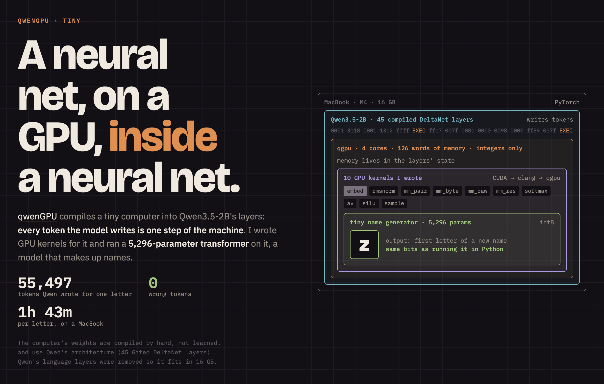
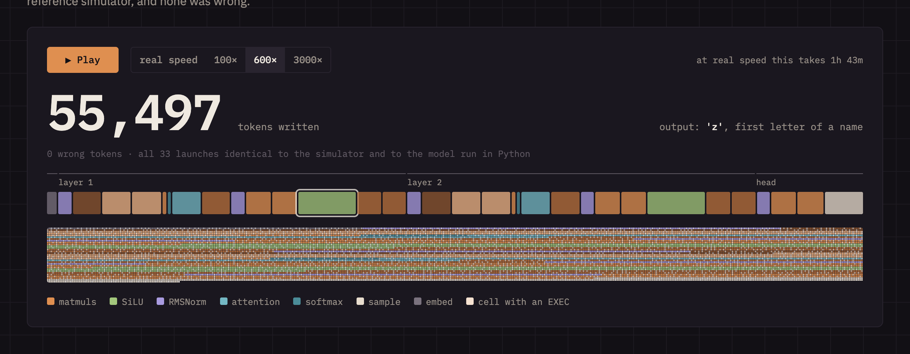
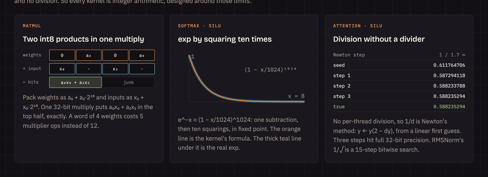

# tiny: a neural net, on a GPU, inside a neural net



▶ [Video: names generated on Qwen, with the tiny model's attention and neurons as Qwen computes them](media/post.mp4) (a replay with real values; [`media/playground.html`](media/playground.html) is the interactive version)

[qwenGPU](https://github.com/vixhal-baraiya/qwenGPU) compiles a small SIMT GPU into the weights of
Qwen3.5-2B. Every token the model writes is one step of that machine: an instruction block or a
register value. Its memory lives in the recurrent state of Gated DeltaNet layers.

This folder runs a real neural network on that GPU. It is a **5,296-parameter character-level
transformer**, trained on Karpathy's makemore `names.txt`, quantized to int8 and written as
**10 CUDA kernels** in qgpu's CUDA subset. A host engine streams weight tiles in and out of the
GPU's 126 words of memory and launches the kernels, 33 launches per generated character.

**Result:** on the compiled Qwen weights, the model wrote **55,497 tokens to produce one letter
(`z`), with zero wrong tokens.** All 33 launches were identical, token for token, to qgpu's
reference simulator, and every buffer matched an independent numpy integer implementation of the
model. On a MacBook M4 that took 1 h 43 min.

| | |
|---|---|
| Model | 2 layers, d = 16, 2 heads, MLP 16→32→16 (SiLU), RMSNorm, context 16 |
| Parameters | 5,296, int8 |
| Validation loss | float 2.0871 → integer 2.0897 nats/char |
| Kernels | 10, all integer, each ≤ 32 machine blocks |
| Launches per character | 33 |
| Tokens per character | ~55–60K written by the model, ~22K fed by the host |
| Speed on the compiled Qwen weights | ~9 tokens/s on an M4 (MPS): 1 h 43 min per character |

## What "running inside Qwen" means here

- **The computer is compiled, not learned.** qwenGPU sets weights by hand so that 45 Gated
  DeltaNet + SwiGLU layers in Qwen's architecture behave as a 4-lane GPU. Registers and memory are
  stored in the DeltaNet recurrent state. The model decodes greedily, and each token it writes is
  either an `EXEC` record (run the next machine block) or the values that block computed.
- **Qwen's own language layers were not used.** The full merged checkpoint (circuit + Qwen's 24
  layers + vision tower) is 15.3 GB in bf16 and did not fit a 16 GB Mac
  ([log](logs/merged-2b-oom.log)). [`gpu_only.py`](gpu_only.py) keeps only the 45 circuit layers,
  the final norm and the chip-token embedding rows, unchanged and bit for bit. That is an 8.7 GB
  text-only Qwen3.5 model. On chip tokens the merge mutes Qwen's own layers anyway, so this
  checkpoint runs the same circuit.
- **One character ran inside the model; many ran on the simulator.** At ~9 tokens/s, a full name
  takes hours. So the long tests use qgpu's reference simulator (`kernel.run_blocks`), and the
  model run checks that the weights produce exactly the simulator's tokens.

## Results

### On the compiled Qwen weights (`build/gpu-only`, MPS, bf16)

One full character, end to end ([log](logs/gpu-only-one-character.log)):

```
1: 'z'                reference 'z'                match (33 launches, 6182.5s)
launches: 33 (33.0 per character)
chip tokens: 55497 written by the GPU, 22141 fed by the host; 3980 machine-block records
verified launches: 33/33
generated tokens by kernel: mm_raw 11328, mm_res 10880, silu 8320, mm_byte 8224, rmsnorm 4705,
                            mm_pair 4056, av 4040, sample 2742, embed 712, softmax 490
```

One launch of each kernel on random inputs ([log](logs/gpu-only-kernels.log)), each identical
to `run_blocks` and to numpy:

| Kernel | Tokens written by the model | Time |
|---|---:|---:|
| embed | 712 | 90 s |
| rmsnorm | 941 | 106 s |
| mm_pair / mm_byte / mm_raw / mm_res | 2,028 / 2,056 / 1,780 / 1,704 | 250 / 252 / 198 / 207 s |
| softmax | 1,808 | 198 s |
| av | 3,924 | 426 s |
| silu | 4,160 | 451 s |
| sample | 2,742 | 297 s |

### On the simulator (`kernel.run_blocks`)

- Every kernel equals the numpy reference on random inputs (20 trials each).
- 20 sampled names (seed 1, 139 characters) are token for token identical to the numpy
  reference, and so is every one of the 4,587 launches.
- Average per character: 33 launches, ~59,700 tokens written, ~22,500 fed by the host, ~4,270
  machine blocks. Position 0 needs fewer (55,497) because attention covers one position.
- Optimization history: 38 launches / 87.7K tokens → fused RMSNorm (33 / 79.4K) → inline-PTX
  matmul step (60.0K) → inline-PTX exp and Newton loops (59.7K).

Sample names: `abda zevery kaekoni arita attonikon espaul teshard abro nyiani biari zakod jonthee
rai prodov jorness yadelyn`



## The machine

qgpu, as compiled into the merged checkpoint: 4 lanes, 4 pipeline stages (multiplies only in
stage 2, logic in stage 1, atomics in stage 3), at most 32 machine blocks per kernel, 15
registers, fewer than 127 words of global memory, 32-bit integers only. Shifts take only
launch-time constants, so a right shift is written as a `mulhi`. There is no per-thread division,
and shuffles need full 32-thread blocks.

The toolchain: CUDA → clang (NVPTX) → PTX → `qgpu.lower` → machine blocks → host tokens. The
model, or the simulator, writes the rest.

## The kernels ([`tiny.cu`](tiny.cu))

| Kernel | Blocks (of 32) | What it does |
|---|---:|---|
| `mm_pair` / `mm_byte` / `mm_raw` / `mm_res` | 22 / 21 / 18 / 19 | One row per thread over a weight tile of ≤ 64 words (16×16 or 8×32). Output as int8 pair format / int8 byte format / int32 / added into the residual stream |
| `embed` | 19 | Token row + position row, rescaled into the residual stream |
| `rmsnorm` | 27 | One warp: 1/rms by a 15-step bitwise search, then gain and int8 |
| `softmax` | 12 | exp(s − max) in Q15, one thread per (head, position) |
| `av` | 31 | Weighted sum of V rows, normalized by a Newton reciprocal |
| `silu` | 24 | v · sigmoid(v), using exp and a Newton reciprocal |
| `sample` | 12 | argmax(logits + Gumbel noise) |



**Two int8 products per multiply.** Weights are stored as bytes, 4 per word (`v + 128`).
Activations use "pair format", two words per 4 values: `x2 + x0·2¹⁶` and `x3 + x1·2¹⁶`. The
kernel splits a weight word into `a0 + a2·2¹⁶` (biased by `0x00800080`). Then one 32-bit
multiply `(a0 + a2·2¹⁶)(x2 + x0·2¹⁶)` puts `a0·x0 + a2·x2` in bits 16–31. This is exact because
|a·x| < 2¹⁵, and the bias `0x80008000` handles the carry. A word of 4 weights costs 5 multiplier
ops instead of 12.

**Hand-scheduled inline PTX.** The driver packs PTX into 4-stage blocks greedily, in program
order. So the dot-product step is inline PTX ordered to fill each block
(`ld | and | mul.hi | sub`, `ld | and | mul | add`, …). That takes 6 blocks per weight word
instead of the 10 that clang's order gave. The exp and Newton loops put the loop counter first,
so the loop's `setp` shares the last block. Pointers go to the asm as `address_space(1)` because
the driver has no `cvta.global`.

**exp without floats.** e^−x ≈ (1 − x/1024)^1024, in Q30: one subtraction, then ten squarings
with `mul.hi`.

**Division without a divider.** 1/d for d in [1, 2) is three Newton steps,
y ← y(2 − d·y), from the linear seed 24/17 − 8/17·d. That gives full 32-bit precision.
`2(2 − dy)` is computed as `−2·mulhi(2D, 2y) mod 2³²`.

**1/rms without a square root.** The largest r < 2¹⁵ with r²·Σx² < th·2³², found bit by bit.
It is exact, so the numpy reference reproduces it.

**RMSNorm without a reduction kernel.** The kernels that write the residual stream (`embed`,
`mm_res`) also `atomicAdd` each new value squared. So `rmsnorm` gets Σx² for free.

**Packing across threads** uses `atomicAdd`: each thread adds its value times its byte or
half-word multiplier into the shared output word.

## Quantization ([`quant.py`](quant.py))

- Weights: int8, one scale per matrix.
- Residual stream: int32 at scale 2⁻⁶ (max |x| ≈ 1,060).
- Matmul inputs: int8 with a per-site scale calibrated on 4,000 names.
- Scores, MLP pre-activations and logits: Q8.
- Every rescale is an integer multiply and shift (M, S), with M < 2¹¹.
- Sampling is Gumbel-max: the host draws the noise from a seeded RNG, and the `sample` kernel
  takes the argmax.

## The host engine ([`engine.py`](engine.py))

One position is 33 launches:
- `embed`
- per layer: `rmsnorm`, q, k, v, scores, `softmax`, `av`, o (+= residual), `rmsnorm`, up ×2,
  `silu`, down ×2 (+= residual)
- then `rmsnorm`, head ×2, `sample`

The host keeps the weights, the K/V caches (byte format, one row per position) and the
activations. Like `cudaMemcpy` around every kernel, it uploads each launch's weight tile and
inputs and reads back the outputs. The host only moves words: every value is computed by a
kernel.

## A qgpu driver bug found on the way

In a loop with `best = v > best ? v : best; idx = v > best ? k : idx;`, clang emits
`setp p, v, best; max best, v, best; selp idx, k, idx, p`. Predicates never cross blocks, so the
driver recomputes the `selp`'s predicate next to it. By then `max` has already overwritten
`best`, so `p` is always false and the argmax stays at 0. `sample` avoids the pattern by
reloading the best value instead of keeping it in a register.
[`repro/argmax.py`](repro/argmax.py) shows it: on `[3, 1, 4, 1, 5, 9, 2, 6]`, the PTX interpreter
returns 5 and the lowered blocks return 0.

## Reproduce

Needs [uv](https://docs.astral.sh/uv/) and Homebrew LLVM (`brew install llvm`, for clang's NVPTX
target). Run from the repository root.

```bash
uv run python tiny/train.py && uv run python tiny/quant.py      # train + quantize (model.pt, qmodel.json are committed)
uv run python tiny/test_kernels.py 20                           # each kernel: simulator == numpy
uv run python tiny/engine.py --backend sim --names 20 --verify  # whole names: simulator == numpy
uv run python tiny/engine.py --eval 200                         # loss: float vs integer
```

On the model weights. This needs the Qwen3.5-2B checkpoint, ~9 GB of free memory and patience:

```bash
uv run python -m qgpu.merge models/Qwen3.5-2B build/merged-2b
uv run python tiny/gpu_only.py build/merged-2b build/gpu-only
uv run python tiny/merged_kernels.py build/gpu-only             # one launch of each kernel, ~45 min
uv run python tiny/engine.py --backend merged --merged build/gpu-only --check --verify --names 1 --max-len 1   # one character, ~1h 45m
```

Open [`media/site.html`](media/site.html) in a browser for the interactive replay of the token
stream ([`media/stream.js`](media/stream.js) is the exact stream from the run above).
[`media/playground.html`](media/playground.html) replays names being generated on Qwen, with the
model's real attention, MLP activations and letter probabilities and the exact token count of every
letter ([`media/make_names.py`](media/make_names.py) makes its data; [`media/render_post.py`](media/render_post.py)
renders [`media/post.mp4`](media/post.mp4)). [`media/clip.mp4`](media/clip.mp4) is a 16-second video of the token stream
(rendered from [`media/clip.html`](media/clip.html) by [`media/render_clip.py`](media/render_clip.py)).

## Files

| File | What it is |
|---|---|
| `train.py` | The float model (PyTorch) and its training |
| `quant.py` | Post-training quantization: int8 weights, calibrated scales, integer rescales |
| `tiny.cu` | The kernels, in qgpu's CUDA subset (`docs/qgpu-cuda.md`) |
| `ref.py` | The numpy integer reference: every kernel, bit for bit |
| `gpu.py` | The driver side: buffers, lowering, and the `sim` / `merged` backends |
| `engine.py` | The host engine: weight-tile streaming, K/V caches, sampling, verification, stats |
| `gpu_only.py` | Cuts the 45 circuit layers out of the merged checkpoint (8.7 GB) |
| `test_kernels.py`, `merged_kernels.py`, `diag.py` | Kernel tests on the simulator and on the model; per-site quantization error |
| `repro/` | The driver bug |
| `media/` | Images and the interactive replay |
| `logs/` | Raw output of the runs quoted above |

`names.txt` is from [karpathy/makemore](https://github.com/karpathy/makemore) (MIT). The GPU,
compiler and runtime are [vixhal-baraiya/qwenGPU](https://github.com/vixhal-baraiya/qwenGPU)
(MIT). Everything in this folder was added on top.
